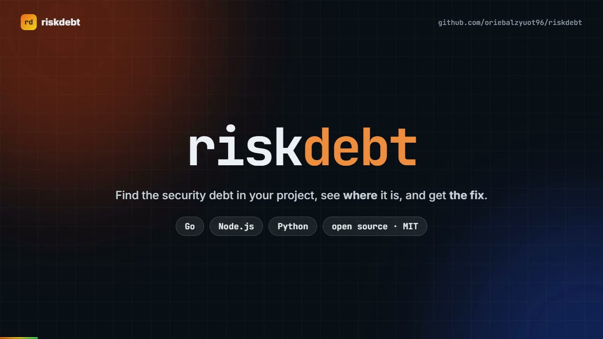

# riskdebt

[](https://www.npmjs.com/package/riskdebt)
[](https://pypi.org/project/riskdebt/)
[](https://pkg.go.dev/github.com/oriebalzyuot96/riskdebt)
[](https://github.com/oriebalzyuot96/riskdebt/actions/workflows/ci.yml)
[](LICENSE)

**Velocity without alignment creates risk debt.** `riskdebt` finds it in seconds, tells you *where* it is, and tells you *how to fix it*.

One zero-dependency scanner, shipped in **three languages** (Go, Node.js, Python) that share the same rules and are tested against each other, so each team can use the stack it already has.

<p align="center">
  <a href="demo/video/riskdebt-demo.mp4"></a><br>
  <sub>▶ <a href="demo/video/riskdebt-demo.mp4">Watch the 48-second explainer</a> (rendered from <a href="demo/video/explainer.html">explainer.html</a>)</sub>
</p>

```text
$ riskdebt .

CRITICAL RD003  package.json:6
  problem: event-stream@3.3.6 is a known-compromised release: malicious flatmap-stream dependency ...
  fix:     Remove or upgrade immediately, rotate every secret reachable from machines or CI that installed it ...

HIGH     RD008  user.component.ts:6
  problem: [Angular] bypassSecurityTrust* disables Angular's sanitizer (XSS)
  fix:     Remove the bypass and bind with [innerHTML] so Angular sanitizes it. If unavoidable, sanitize ...

HIGH     RD006  .claude/settings.json:4
  problem: Agent permission mode is bypassPermissions, so every action runs without human approval
  fix:     Use the default or acceptEdits mode and reserve bypass for disposable sandboxes without credentials.

52 findings: 7 critical, 20 high, 24 medium, 1 low
```

## Why this exists

This week's headlines repeat the same story: a popular AI library was compromised for a couple of hours and stole cloud keys, PHP shipped emergency fixes for remote-code-execution bugs while hundreds of thousands of servers run versions that will never be patched, and AI agents are being handed broad permissions with nobody watching. The foundations are not keeping up with the speed of adoption.

`riskdebt` turns four principles into checks you can run in a terminal, a pre-commit hook or CI:

| Principle | What riskdebt checks |
|---|---|
| **Build security in from day one** (treat every AI agent like a new employee: least privilege, scoped credentials, human approval) | Agent configs: unrestricted `Bash(*)`, `bypassPermissions`, unpinned MCP servers, literal tokens in MCP config |
| **Secure the supply chain and foundations** (pin, verify, monitor, retire EOL) | Unpinned/floating dependencies, missing lockfiles, known-compromised releases, unpinned GitHub Actions, end-of-life Node/Python/PHP |
| **Govern, don't block** | A ready-to-adopt [AI tool policy template](docs/AI-AGENT-POLICY.md) plus `--fail-on` so you choose the gate |
| **Fight AI with AI** | Fast, offline, machine-readable (`--format json`) so it slots into automated pipelines and agent loops |

## What it checks

| Rule | Finds | Ecosystems |
|---|---|---|
| RD001 | Unpinned / floating dependencies | npm, pip, NuGet |
| RD002 | Missing lockfile / hashes | npm, pip |
| RD003 | Known-compromised package versions (extendable) | npm, PyPI |
| RD004 | Leaked secrets: AWS, GitHub, Anthropic, OpenAI, Slack, Google, private keys, generic credentials | any text file |
| RD005 | End-of-life runtimes (`.nvmrc`, `.python-version`, `runtime.txt`, `Dockerfile FROM`) | Node, Python, PHP |
| RD006 | Risky AI-agent / MCP configuration | Claude Code, Cursor, VS Code MCP |
| RD007 | GitHub Actions not pinned to a commit SHA | GitHub Actions |
| RD008 | Insecure code patterns, with framework-specific fixes | **Angular, React, .NET, Node.js, PHP, Python** |
| RD009 | GitHub Actions hardening: `pull_request_target` checking out PR code, script injection, `write-all` or missing `permissions`, `curl \| sh` | GitHub Actions |

### Mapped to the standards your auditors use

Every finding carries its **CWE** and **OWASP** ids (OWASP [Top 10:2025](https://owasp.org/Top10/), e.g. `A05:2025`, and the [Top 10 for LLM applications](https://genai.owasp.org/), e.g. `LLM06:2025`), in the text report, in `--format json`, and in SARIF, where GitHub shows the CWE next to each alert and uses a 0-10 `security-severity` for the critical/high/medium/low label.

```text
HIGH     RD008  user.component.ts:6  [CWE-79 · A05:2025]
  problem: [Angular] bypassSecurityTrust* disables Angular's sanitizer (XSS)
```

The mapping is the closest fit, not a certification: use it to group and report, and check the category yourself before quoting it in an audit.

### Framework coverage (RD008)

- **Angular**: `bypassSecurityTrust*` (sanitizer bypass), dev-server host check disabled
- **React / SPA**: `dangerouslySetInnerHTML`, auth tokens in `localStorage`, `innerHTML`, `eval`, `document.write`
- **.NET**: SQL built by concatenation / `FromSqlRaw` interpolation, `BinaryFormatter`, Json.NET `TypeNameHandling`, `Html.Raw`, `AllowAnyOrigin`, certificate validation disabled, passwords in connection strings, floating NuGet versions
- **PHP**: user input into `system()`/`exec()`, `unserialize()` on request data, `eval`, EOL PHP versions
- **Node.js / Python**: TLS verification disabled, `shell=True`, `pickle`, SQL injection, CORS `*`, weak hashes, `debug=True`
- **Where tokens are saved**: `localStorage`/`sessionStorage`, `document.cookie`, tokens in URLs, tokens in logs, hard-coded JWT secrets, JWT `none` algorithm, .NET cookies without `HttpOnly`/`Secure`, disabled JWT validation
- **Docker**: mutable `:latest` base images

Every finding includes a `problem` and a concrete `fix`. Full list: [docs/RULES.md](docs/RULES.md).

## Install and run

Pick the implementation that matches your stack. They produce identical findings.

```bash
# Node.js (>= 20) - no install needed
npx riskdebt .

# Python (>= 3.9)
pip install riskdebt
riskdebt .

# Go
go install github.com/oriebalzyuot96/riskdebt/cmd/riskdebt@latest
riskdebt .
```

```text
riskdebt [path] [options]

  -f, --format <text|json|sarif>   output format (default text)
      --fail-on <severity>   exit 1 at or above critical|high|medium|low|none (default high)
      --today <YYYY-MM-DD>   reproducible EOL checks
      --blocklist <file>     add your own compromised-package list
      --exclude <pattern>    skip paths, .gitignore-style (repeatable)
      --no-gitignore         do not read .gitignore (honoured by default)
      --max-size <KB>        skip files larger than this (default 1024)
```

Add `// riskdebt-ignore` (any comment style) on a line to suppress a secret or code-pattern finding there.

### Adopt it on an existing codebase: baseline and diff-only

A first scan of a mature repo can show hundreds of old findings. Two features let a team adopt riskdebt without fixing the past first:

```bash
riskdebt . --write-baseline .riskdebt-baseline.json   # record everything that exists today (commit this file)
riskdebt .                                            # from now on only NEW findings are shown (the file is read automatically)
riskdebt . --since origin/main                        # in a pull request: only findings on lines the PR changed
```

- A finding is identified by its rule, file and the **text** of the offending line, not its line number, so it stays "known" when code above it moves, and becomes new if the offending line itself changes.
- The report says how many known findings are hidden and how many baseline entries no longer match anything (refresh the file with `--write-baseline` to prune them). `--no-baseline` shows everything again.
- `--since <ref>` reads `git diff`; it needs git history (in GitHub Actions use `fetch-depth: 0`). It also counts untracked files, and keeps file-level findings (such as a missing lockfile) of any file that changed.
- A baseline written by the Go, Node.js or Python build works with the other two.

### Large repositories

riskdebt is built for big monorepos: it never reads what it should not, and tells you what it skipped.

- **`.gitignore` is honoured**, the root one and the ones in sub-folders, scoped the way git scopes them (a rule in `apps/web/.gitignore` only applies inside `apps/web`). Build output, caches and local files are usually in them. Plus an optional **`.riskdebtignore`** in the scan root with the same syntax (`dir/`, `*.log`, `/root-only`, `**/generated/`; negation is not supported). Add more on the command line with `--exclude 'models/'`, or turn `.gitignore` off with `--no-gitignore`.
- **Skipped by default:** `node_modules`, `.git`, `dist`, `build`, `bin`, `obj`, `.next`, `.angular`, `.nuxt`, `coverage`, `.cache` and similar; minified files and source maps; and binary, media and **machine-learning model files** (`.onnx`, `.gguf`, `.safetensors`, `.pt`, `.h5`, `.pkl`, `.parquet` and more). Files over 1 MB and single lines over 4000 characters (minified bundles) are skipped too.
- **Fewer false positives:** the generic "hard-coded credential" rule skips placeholders (`PASTE_TOKEN_HERE`, `your-api-key`, `changeme`, `replace-with-...`) and values that read like words rather than random secrets, such as routes (`users/RefreshToken`), error codes (`app_WrongPassword`) and CSS variables (`--primary-color`). Real-looking values are still reported, and `riskdebt-ignore` on a line silences a reviewed one.
- **Nothing is skipped silently:** the first line of the report says how many folders and files were skipped, and `--format json` has a `skipped` object. A clean result on a repo where most files were skipped is not full coverage.
- **Fast:** each rule carries `hints` (keywords every match must contain), so a regex only runs on files and lines that could match. The Go build also scans files in parallel. On a 37,000-file .NET and Angular monorepo, a scan that did not finish in 3 minutes before now takes about 5 seconds (Go). The hints can never hide a finding; a test proves it.

### In GitHub Actions (with code-scanning alerts)

```yaml
permissions:
  contents: read
  security-events: write   # lets results appear in the Security tab

steps:
  - uses: actions/checkout@v4
  - uses: oriebalzyuot96/riskdebt@main   # pin to a release tag or commit SHA
    with:
      fail-on: high
```

On pull requests, gate only on what the PR adds (the code-scanning upload still contains the full results):

```yaml
  - uses: actions/checkout@v4
    with:
      fetch-depth: 0
  - uses: oriebalzyuot96/riskdebt@main
    with:
      since: origin/${{ github.base_ref }}
```

Findings show up as alerts in **Security → Code scanning**, each with its fix. Or output SARIF yourself: `riskdebt . --format sarif > riskdebt.sarif`.

## Make it yours

The point of an internal tool is that it can encode *your* business logic. Everything is data in [`rules/`](rules): add a secret pattern, a framework smell, an EOL date, or a compromised version to a JSON file and all three implementations pick it up. When a new package is compromised, add it to `compromised.json` (or pass `--blocklist`) and your whole org is protected the same day.

## How the three ports stay honest

`scripts/conformance.mjs` runs the Go, Node.js and Python CLIs against shared fixtures and fails CI if their findings differ by even one line number.

```bash
node scripts/conformance.mjs
```

## Honest limits

`riskdebt` is a fast, offline, heuristic first line of defence. It reads files with regexes and a few parsers; it does not do data-flow analysis, query live vulnerability databases, or replace a SAST/SCA product, a pentest, or patching. The EOL and compromised lists are curated by hand: verify against [endoflife.date](https://endoflife.date) and your advisory feed. Expect some false positives; tune with `--fail-on`, `riskdebt-ignore` and your own rules.

## Roadmap

- Live advisory lookups (OSV) behind an opt-in flag
- More lockfile formats (`yarn.lock`, `pnpm-lock.yaml`, `poetry.lock`, `packages.lock.json`)
- Rules for Java/Spring, Ruby/Rails, Go, Terraform and Kubernetes manifests
- Pre-commit hook

Ideas and rules welcome: see [CONTRIBUTING.md](CONTRIBUTING.md).

## بالعربي

`riskdebt` أداة مفتوحة المصدر تفحص مشروعك وتخبرك **أين المشكلة الأمنية وكيف تصلحها**: حزم غير مثبّتة، أسرار مسرّبة، إصدارات منتهية الدعم (Node / Python / PHP)، إعدادات خطيرة لوكلاء الذكاء الاصطناعي، وثغرات شائعة في Angular وReact و .NET. متوفرة بثلاث لغات (Go وNode.js وPython) بنفس القواعد. القواعد كلها ملفات JSON في مجلد `rules/` فيمكنك إضافة قواعد فريقك بسهولة.

## License

[MIT](LICENSE)
